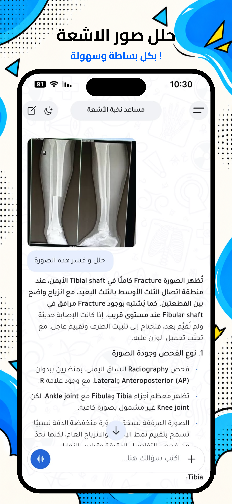

# Shotly

> **Design app screenshots. Make every screen count.**
>
> صمّم لقطات تطبيقك باحتراف، واجعل كل شاشة تحكي قصتها.

Shotly is a browser-based editor for creating coordinated app-store screenshots. Arrange up to five screens, add your own app captures and branding, customize the copy and backgrounds, then export sharp PNG images.

[Browse the editor source](https://github.com/ln6ie/Shotly/tree/main/src/app/editor) · [Source code](https://github.com/ln6ie/Shotly)

<p align="center">
  
</p>

## Features

- Create a connected set of up to five app screenshots.
- Edit headings, supporting text, and badges directly on the canvas.
- Add an app screenshot, logo, and custom background image to each screen.
- Choose portrait or landscape layouts, device frame colors, and background colors.
- Export individual screens or the complete set as high-resolution PNG files.
- Work in Arabic and English layouts from a responsive browser editor.

## Get started

Requirements: Node.js and [pnpm](https://pnpm.io/installation).

```bash
pnpm install --frozen-lockfile
pnpm dev
```

Open <http://localhost:3000> and choose **Open editor**. To check TypeScript without generating a production build:

```bash
pnpm exec tsc --noEmit
```

## How to use

1. Open the editor and add an app screenshot to each screen you want to prepare.
2. Edit the text on the canvas, then add a logo and choose colors or a background image.
3. Select each screen to adjust its orientation and device frame.
4. Export the current screen or download the complete set as PNG files.

## Privacy and acceptable use

Shotly has no account system or image-upload server. Images selected in the editor are read by the browser for canvas composition and export. The visitor counter contacts CounterAPI; see its privacy terms before deploying the counter in a privacy-sensitive environment.

You are responsible for having permission to use the screenshots, logos, fonts, and other material you add. Check the current submission and image-size requirements of the store where you plan to publish your screenshots. Do not use Shotly to infringe another person's rights or create deceptive store listings.

## License and rights

The Shotly source code is released under the [MIT License](LICENSE). The license applies to this repository's code; it does not grant rights to third-party names, trademarks, fonts, dependencies, or content you upload. Third-party packages remain under their respective licenses.

Copyright © 2026 ln6ie. Shotly and its logo are project identifiers; the MIT License does not grant a trademark license.

## المميزات بالعربية

- صمّم مجموعة متناسقة من خمس شاشات للتطبيق.
- عدّل العناوين والنصوص والشارات مباشرة على التصميم.
- أضف صورة التطبيق والشعار وخلفية مخصصة لكل شاشة.
- اختر الاتجاه العمودي أو العرضي ولون إطار الجهاز والخلفية.
- صدّر شاشة واحدة أو المجموعة كاملة بصيغة PNG عالية الدقة.
- استخدم المحرر من المتصفح بواجهات عربية وإنجليزية متجاوبة.

### الاستخدام بالعربية

يتطلب المشروع Node.js وpnpm. نفّذ `pnpm install --frozen-lockfile` ثم `pnpm dev` وافتح `http://localhost:3000`.

المشروع لا يوفّر نظام حسابات أو خادماً لرفع الصور؛ يقرأ المتصفح الصور لإضافتها إلى التصميم وتصديرها. يتصل عدّاد الزوار بخدمة CounterAPI. المستخدم مسؤول عن امتلاك حق استخدام الصور والشعارات والمواد التي يضيفها، وعن مراجعة متطلبات المتجر المستهدف.
